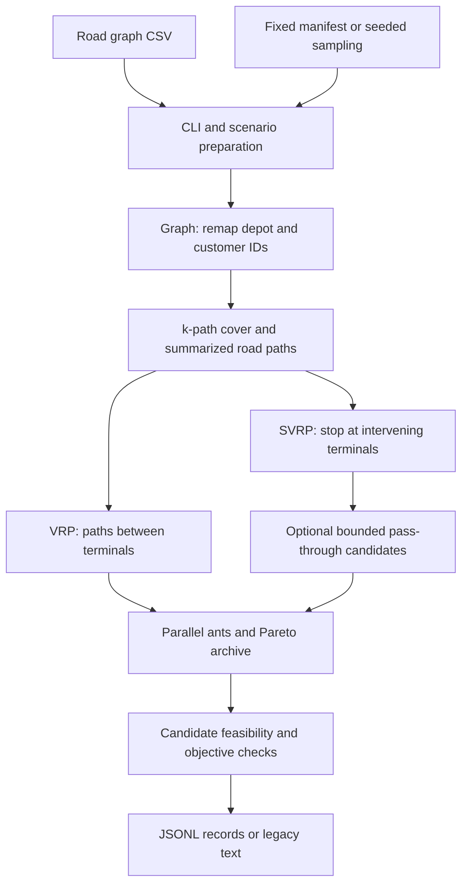

# Implementation guide

## Data flow

## Representations and ownership

`main.cpp` reads the graph and prepares depot/customer scenarios. The graph
constructor remaps the depot to zero and the customers to a contiguous block;
it retains mappings back to the original node IDs. The two solver instances
receive their own graph values and use the same scenario and ACO seed for a
paired comparison.

Both solvers first select a k-path cover and summarize paths between cover
vertices. Their subsequent multicriteria searches produce a terminal-level
`ShrinkGraph`: its arcs retain the underlying road-node sequences and cost
summaries. The intermediate cover graph and the final terminal planning graph
are different representations; retained noncustomer cover vertices are not
additional customer endpoints in the final graph.

The complete variant searches through intervening terminals. The sparse
variant normally stops a search at the next terminal. With pass-through
candidates enabled, it adds a bounded set of paths that cross intermediate
customers and counts those customers as served. A separate option compares
direct moves with planned multi-arc moves during sparse route construction.

## Optimization and output

Each ant uses a preference between the two objectives and its own seeded
random-number generator. Ant construction runs in parallel. Candidate results
are collected in ant order, checked, and merged into the iteration and global
Pareto archives before pheromones are updated. The stop condition counts
consecutive iterations without an archive improvement.

Candidate validators check continuity, customer coverage, return to the depot,
the battery/resource limit, vehicle count, and reported objective totals at
the planning-arc level. Each route resets its accumulated resource at the
depot. Both objective components are minimized over the full collection of
routes.

`SolverResult.h` owns structured solver outcomes; `ExperimentIO` reads scenario
manifests and serializes JSONL. The JSONL format includes objective pairs and
route counts, but not full road routes. Its statuses must be inspected even
when the executable exits successfully.

## Reading and testing

Start with `main.cpp`, then `Graph`, `ShrinkGraph`, and the result-returning
entry points of the two ant-colony classes. `tests/test_solver_correctness.py`
uses synthetic graphs with hand-derived answers to exercise the executable.
These small cases check specific invariants; they do not establish global
optimality for a heuristic on arbitrary inputs.

Unused private coordinate exporters, local-search helpers, and declarations
have been removed. Public legacy entry points remain for source compatibility;
the documented CLI uses the validated result methods. One historical RNG draw
from a disabled mutation branch is deliberately retained to preserve seeded
behavior. The original research note remains local because it describes an
older solver revision.
